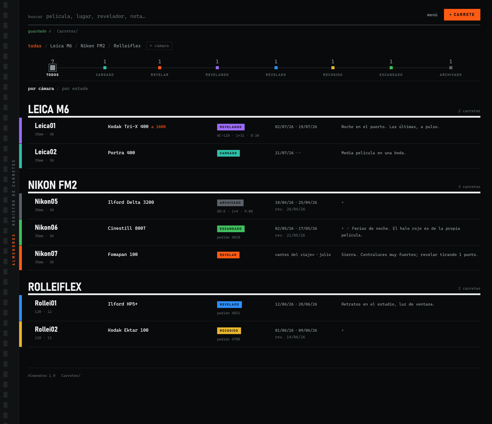
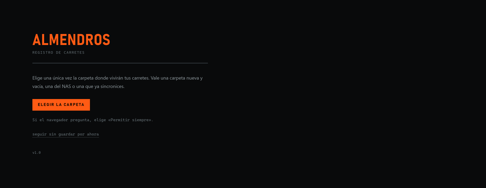
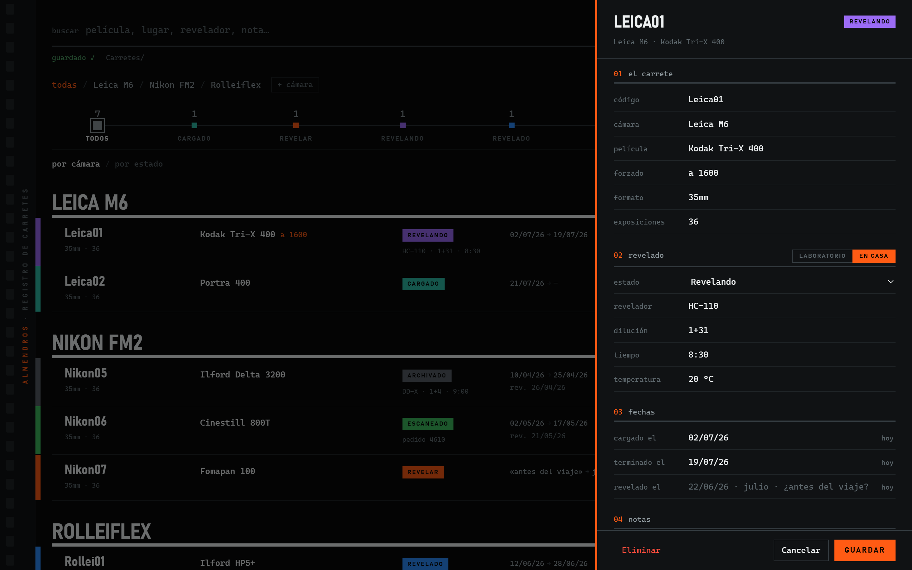

<p align="center">
  <a href="README.md"></a>
  
</p>

<p align="center">
  
</p>

# 🎞️ Almendros — un registro de carretes en un solo archivo HTML

**Apunta cada carrete que disparas** — en qué cámara va, qué película, si lo forzaste, si lo
revelaste tú o fue al laboratorio, y *dónde acabó el negativo*. Almendros es un cuaderno de
carretes para fotografía analógica que funciona desde un único archivo HTML y guarda en una
carpeta tuya.

Sin cuentas. Sin servidores. Sin cuotas. Sin telemetría. Sin límite de carretes.

<p>
  <a href="LICENSE"></a>
  
  
</p>

**[▶ Probar la demostración](https://jaimealekos.github.io/almendros/?lang=es#demo)**
(carretes de ejemplo, no guarda nada) ·
**[Abrir la aplicación](https://jaimealekos.github.io/almendros/?lang=es)**

---

## Para qué sirve

Cargas un carrete. Lo disparas durante tres semanas. Se queda en un cajón, va al
laboratorio, vuelve. Dos años después quieres ese fotograma — y el negativo está en una de
once fundas sin marcar.

Almendros responde a las dos preguntas que se hace todo el que tira película:

- **¿Qué llevo en esta cámara, y la estaba tirando a su ISO?**
- **¿Dónde demonios guardé ese negativo?**

Diez segundos por carrete. Ese es todo el compromiso.

## Empezar

Descarga [`index.html`](https://raw.githubusercontent.com/jaimealekos/almendros/main/index.html)
(botón derecho → Guardar enlace como) y ábrelo con doble clic en **Chrome**, **Edge** o
**Brave**, en un ordenador: son los únicos que saben escribir en una carpeta tuya. La
primera vez te pregunta dónde quieres que vivan tus carretes:



Señala la carpeta que quieras: una nueva y vacía, una del NAS, una que ya sincronices.
Después, **+ Carrete**, arriba a la derecha. Con tres cosas basta —**código**, **cámara** y
**película**— y Almendros ya te propone el código siguiente de esa cámara.

También puedes usarlo directamente desde
[la página alojada](https://jaimealekos.github.io/almendros/?lang=es) sin descargar nada:
sigue guardando en tu propia carpeta.

**¿Prefieres no usar navegador?** Descarga
[`Almendros.exe`](https://github.com/jaimealekos/almendros/releases/latest/download/Almendros.exe),
ponlo junto a `index.html` y tus datos, y ábrelo: escribe en la carpeta directamente, sin
pedir permiso nunca. No está firmado, así que Windows avisará de «editor desconocido» la
primera vez. Para macOS hay que compilarlo: los tres comandos están en
[`escritorio/`](escritorio/).

## Cómo se usa

Cada carrete está siempre en una fase, y cada fase tiene su color:

**Cargado** → **Revelar** → **Revelando** → **Revelado** → **Recogido** → **Escaneado** →
**Archivado**

**Pulsa la etiqueta de color de un carrete y pasa a la fase siguiente.** Es el único gesto
que hay que aprender. ¿Te equivocas? Abajo aparece un aviso con **Deshacer** — vale para
cambios de estado, carretes borrados y cámaras quitadas.

Abre un carrete para lo demás: cómo lo revelaste (laboratorio y número de pedido, o
revelador, dilución, tiempo y temperatura), dónde guardaste el negativo y un enlace a los
escaneos.



En corto, el resto: la búsqueda mira dentro de todos los campos · las fechas son texto libre
(`22/06/26`, `julio`, `¿antes del viaje?`) · agrupa por cámara o por estado · temas oscuro y
claro · español e inglés, sin tocar nunca tu archivo · imprime una hoja limpia para el
laboratorio · exporta a `.csv` · atajos `N` `/` `Esc` `Ctrl+Intro`.

## Tus datos

Un archivo de texto normal en la carpeta que elegiste, con una copia diaria al lado:

```
tu carpeta/
├── almendros.json      ← todos los carretes que has disparado
└── copias/             ← copias diarias, se conservan 30
```

Puedes abrirlo con el Bloc de notas y entenderlo leyéndolo. **Si mañana este proyecto
desapareciera, tu registro seguiría ahí, legible, sin mí.** Ese es el sentido entero del
formato.

**Varios ordenadores, una carpeta.** Ponla en un disco de red o en una carpeta sincronizada
y abre la página donde quieras. Almendros fusiona carrete a carrete —cada uno sabe cuándo se
tocó por última vez y cada borrado deja su marca—, así que dos ordenadores que editan
carretes distintos conservan los dos su trabajo. Edita el *mismo* carrete a la vez en dos
sitios y gana el último que escriba.

**Sin conexión no pasa nada.** Si la carpeta no está accesible, los cambios esperan y se
escriben en cuanto vuelva.

## Tres límites honestos

1. **Para guardar en una carpeta hace falta Chrome, Edge o Brave, en un ordenador.** Firefox
   y Safari todavía no saben escribir en carpetas — o prescinde del navegador y usa la
   aplicación de escritorio.
2. **En el móvil funciona, pero no puede guardar en una carpeta.** Todo se queda dentro del
   navegador y la copia la descargas tú. Es una herramienta de mesa, no de bolsillo.
3. **No apunta foto a foto**, y es a propósito. Nadie mantiene un registro por fotograma más
   allá del tercer carrete, y el carrete es la unidad que maneja el laboratorio, que cabe en
   la funda y que de verdad se pierde. Si quieres fotogramas,
   [Exif Notes](https://github.com/tommi1hirvonen/ExifNotes) y
   [Crown + Flint](https://crownandflint.com/) lo hacen bien.

## Desarrollo

Todo está en `index.html`: CSS, HTML y un único script sin dependencias. Sin compilar, sin
red en tiempo de ejecución — tiene que funcionar desde `file://` con el wifi apagado. Para
trabajar en él, ábrelo. Ese es todo el instrumental. El modelo de datos y los invariantes
están en [ARQUITECTURA.md](ARQUITECTURA.md).

- **`index.html#pruebas`** — las pruebas internas, en la propia página.
- **`index.html#demo`** — carretes de ejemplo en memoria, no guarda nada.
- **`python capturas/generar.py`** — rehace las capturas en los dos idiomas.
- **`python escritorio/pruebas/costura.py`** — comprueba la costura de escritorio contra un
  anfitrión falso.
- **`cargo test`** en `escritorio/src-tauri` — las pruebas de la aplicación de escritorio.
  Cómo compilarla, en [escritorio/README.md](escritorio/README.md).

Se agradecen ideas y avisos de fallos, sobre todo de quien revela en casa.

## Licencia

[MIT](LICENSE) — libre para usar, copiar, mejorar y compartir.

---

Apuntar un carrete cuesta diez segundos, que es justo por lo que lo vas a hacer.
