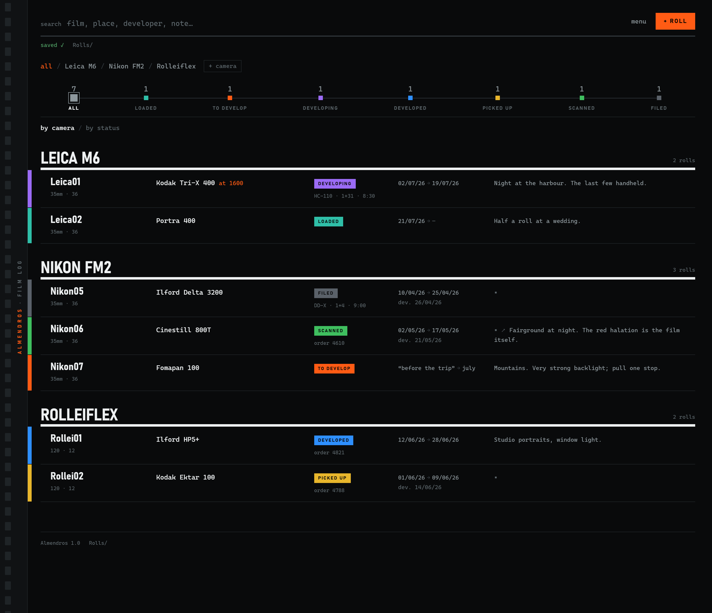
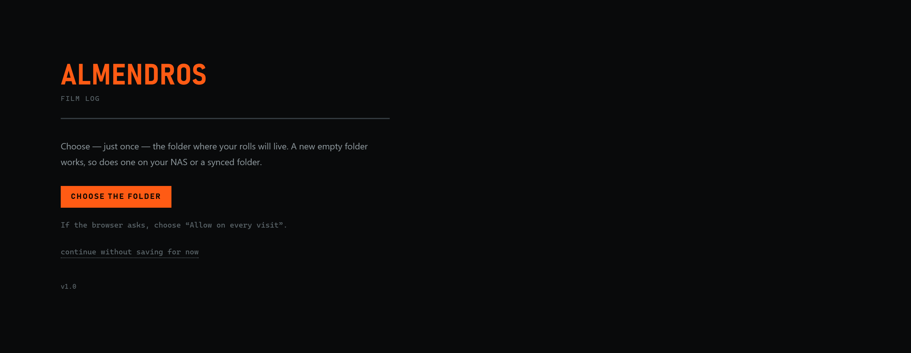
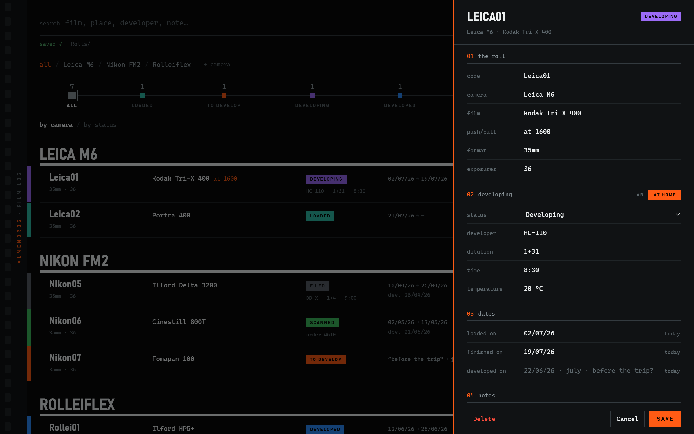

<p align="center">
  
  <a href="LEEME.md"></a>
</p>

<p align="center">
  
</p>

# 🎞️ Almendros — a film photography logbook in a single HTML file

**Track every roll of film you shoot** — which camera it's loaded in, what stock, push or
pull, whether it went to a lab or into your own tank, and *where the negative ended up*.
Almendros is a film log for analog (analogue) photographers that runs from one HTML file and
saves into a folder you own.

No account. No server. No subscription. No telemetry. Unlimited rolls.

<p>
  <a href="LICENSE"></a>
  
  
</p>

**[▶ Try the demo](https://jaimealekos.github.io/almendros/?lang=en#demo)** (sample rolls,
nothing saved) · **[Open the app](https://jaimealekos.github.io/almendros/?lang=en)**

---

## What it's for

You load a roll. You shoot it over three weeks. It sits in a drawer, goes to the lab, comes
back. Two years later you want that one frame — and the negative is in one of eleven sleeves
with no markings.

Almendros answers the two questions every film photographer asks:

- **What's in this camera, and was I shooting it at box speed?**
- **Where the hell did I file that negative?**

Ten seconds per roll. That's the whole commitment.

## Getting started

Download [`index.html`](https://raw.githubusercontent.com/jaimealekos/almendros/main/index.html)
(right-click → Save link as) and open it with a double click in **Chrome**, **Edge** or
**Brave** on a computer — they are the only browsers that can write into a folder of yours.
The first time, it asks where your rolls should live:



Point it at any folder: a new empty one, one on your NAS, one you already sync. Then
**+ Roll**, top right. Three things are enough — **code**, **camera** and **film** — and
Almendros already suggests the next code for that camera.

You can also use it straight from
[the hosted page](https://jaimealekos.github.io/almendros/?lang=en) without downloading
anything: it still saves into your own folder.

**Rather not use a browser?** Download
[`Almendros.exe`](https://github.com/jaimealekos/almendros/releases/latest/download/Almendros.exe),
put it next to `index.html` and your data, and open it: it writes the folder directly, with
no permission prompt, ever. It isn't signed, so Windows warns about an unknown publisher the
first time. For macOS you build it yourself — [`escritorio/`](escritorio/) has the three
commands.

## How it works

Every roll is always at some stage, and every stage has its colour:

**Loaded** → **To develop** → **Developing** → **Developed** → **Picked up** → **Scanned** →
**Filed**

**Click a roll's coloured label and it moves to the next stage.** That's the only gesture
worth learning. Got it wrong? A notice appears at the bottom with **Undo** — it works for
status changes, deleted rolls and removed cameras.

Open a roll for the rest: how you developed it (lab and order number, or developer,
dilution, time and temperature), where the negative is filed, and a link to the scans.



Briefly, the rest: search looks inside every field · dates are free text (`22/06/26`,
`july`, `before the trip?`) · group by camera or by status · dark and light themes · English
and Spanish, without ever touching your file · print a clean sheet for the lab · export to
`.csv` · shortcuts `N` `/` `Esc` `Ctrl+Enter`.

## Your data

One plain text file in the folder you chose, with a daily backup beside it:

```
your folder/
├── almendros.json      ← every roll you have ever shot
└── copias/             ← daily backups, last 30 kept
```

You can open it in Notepad and understand it by reading it. **If this project disappears
tomorrow, your log is still there, still legible, without me.** That's the whole point of
the format.

**Several computers, one folder.** Put it on a NAS or a synced drive and open the page
anywhere. Almendros merges roll by roll — each roll knows when it was last touched and each
deletion leaves a marker — so two computers editing different rolls both keep their work.
Edit the *same* roll in two places at once and the last write wins.

**Offline is fine.** If the folder is unreachable, changes wait and are written the moment
it's back.

## Three honest limits

1. **Saving to a folder needs Chrome, Edge or Brave on a desktop.** Firefox and Safari can't
   write to folders yet — or skip the browser and use the desktop app.
2. **On a phone it runs, but it can't save to a folder.** Everything stays inside the
   browser and you download a copy when you want one. It is a desk tool, not a pocket one.
3. **It does not log frame by frame** — on purpose. Nobody keeps a per-frame log past roll
   three, and the roll is the unit the lab handles, the sleeve holds and you actually lose.
   If you want frames, [Exif Notes](https://github.com/tommi1hirvonen/ExifNotes) and
   [Crown + Flint](https://crownandflint.com/) do it well.

## Development

Everything is in `index.html`: CSS, markup and one vanilla script. No build step, no
dependencies, no network access at runtime — it has to work from `file://` with the wifi
off. To work on it, open the file. That's the whole toolchain. The data model and the
invariants are in [ARQUITECTURA.md](ARQUITECTURA.md).

- **`index.html#pruebas`** — the built-in test suite, run in the page itself.
- **`index.html#demo`** — sample rolls in memory, saves nothing.
- **`python capturas/generar.py`** — regenerates the screenshots in both languages.
- **`python escritorio/pruebas/costura.py`** — checks the desktop seam against a fake host.
- **`cargo test`** in `escritorio/src-tauri` — the desktop app's own tests.
  [escritorio/README.md](escritorio/README.md) has the build instructions.

Bug reports and ideas are welcome, especially from photographers who develop at home.

## Licence

[MIT](LICENSE) — free to use, copy, improve and share.

---

Logging a roll takes ten seconds, which is exactly why you'll actually do it.
